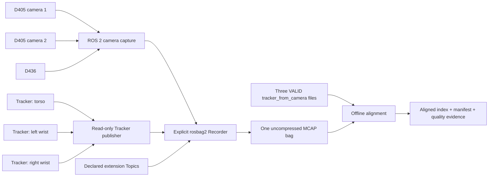

# VisionTactile-Dataset

[](https://github.com/yanglei18/VisionTactile-Dataset/actions/workflows/ci.yml)


[](LICENSE)

[简体中文](README.zh-CN.md) ·
[User quick start](docs/quickstart.md) ·
[Desktop workbench](tools/capture_console/README.md) ·
[User manual](docs/user-manual.md) ·
[Interfaces](docs/interface-reference.md) ·
[Troubleshooting](docs/troubleshooting.md)

ROS 2 acquisition, a desktop workbench, and offline alignment for **three Intel
RealSense cameras**, **three VIVE Ultimate Trackers**, and optional **left/right
IMU gloves and tactile arrays**.

The repository provides the software needed to acquire two D405 cameras, one
D436 camera, and three read-only Tracker pose streams into one explicit MCAP
bag. Embedded guided and standalone offline workflows calibrate each fixed
Tracker-to-camera pair. Offline alignment produces an auditable, host-time-aligned
dataset index without modifying the raw bag.

## End users: install and use

Use the **complete graphical installer for Ubuntu 24.04 x86_64** supplied with your equipment. No source checkout or manual Python, ROS or camera-driver installation is required.

1. Open the **complete download link** supplied with your equipment and click **Download installer**. No GitHub login, account registration or download password is needed.
2. Extract the whole archive, open **Install-VisionTactile**, and click **Install**. Enter this computer's administrator password when the operating system asks.
3. Open the workbench, connect your equipment, and confirm the actual devices and their physical roles.

See the [user quick start](docs/quickstart.md) for installation, first use and common situations, and the [workbench guide](tools/capture_console/README.md) for device control, recording, archive playback and calibration.
The [public download home page](https://yanglei18.github.io/VisionTactile-Downloads/) explains delivery; the complete link supplied with the equipment opens its matching package.
The installer prepares the application, camera environment and matching Tracker setup. Licensed hand models, separate gesture solving and specialized calibration environments are optional components prepared by the maintainer.

## Version and delivery scope

The desktop workbench adds device configuration, previews, explicit node
control, trial management, and post-record quality reports. It is a **development
preview**, not a fully accepted turnkey hardware product. A synthetic demo runs
without ROS, sensors, private Tracker inputs, or MANO models.

> [!IMPORTANT]
> This is acquisition and post-processing software, not a downloadable
> dataset. Recorded bags, device credentials, Tracker bootstrap material,
> role maps, rig-specific extrinsics, and licensed MANO models are deliberately
> kept outside Git. A clean clone does not include a configured hardware rig.

This repository publishes a **source development preview**; matching Ubuntu graphical installers are delivered separately through complete sign-in-free links. The workbench
package version `0.6.0` identifies that component; it does not mean that these
changes have been published under a matching project tag. See
[Unreleased changes](CHANGELOG.md#unreleased) for the candidate scope.
The independent tactile viewer has its own version, `0.5.1`, and bilingual
Chinese/English UI. Its [Windows installer build tooling](tools/tactile_viewer_windows/README.en.md)
is included as source; this public source preparation does not include a
redistribution-authorized model or a public Windows installer download.

| Workflow | Prerequisites beyond this source |
| --- | --- |
| Synthetic desktop demo and tests of public dependency paths | Public Python/Qt dependencies; ROS dependencies for ROS tests |
| RealSense capture and tactile acquisition | Supported hardware, drivers, device permissions and local configuration |
| Production Tracker acquisition | Separately obtained extended PyVUT runtime, Windows mapping and private bootstrap/role inputs; the public submodule alone is insufficient |
| FSGlove/MANO hand reconstruction | Separately obtained FSGlove source, the corresponding licensed MANO models, calibration and optional model environment |
| Independent fixed-hand tactile viewer and Windows packaging | Serial tactile hardware; an authorized static model bundle, or a licensed MANO model and separate model environment; Windows builds require an explicitly supplied model and its license |
| Calibrated joint camera/Tracker view | Accepted identity-bound extrinsics for the actual rig and matching map configuration |

The public PyVUT pin does not contain a license file; this project's license
does not grant rights to that code. Dependency and model boundaries are listed
in [third-party notices](THIRD_PARTY_NOTICES.md). Tests with synthetic inputs do
not establish full-rig reproducibility, accuracy or sustained 30 Hz recording.

## Why this project exists

Multi-device experiments often fail silently: the wrong physical device is
assigned to a logical role, ROS QoS drops a stream, a camera clock resets, or a
Recorder exits successfully even though the resulting data are unusable. This
project makes those boundaries explicit:

- cameras are bound by model, serial number, firmware, and ASIC identity;
- Tracker samples are bound to stable experiment roles and physical IDs;
- recording uses an exact, wildcard-free Topic allowlist;
- source clocks and host clocks remain distinguishable;
- Recorder lifecycle success and dataset quality are separate verdicts;
- calibration and alignment outputs are immutable and independently
  verifiable.

## Features

| Capability | Status | Entry point |
| --- | --- | --- |
| Integrated desktop capture console | v0.5 development preview: graphical setup, explicit device control, persistent Tracker setup inputs, four device preview types with enlarged views, trials and post-record reports; full hardware acceptance pending | [Capture console](tools/capture_console/README.md) |
| Joint spatial visualization | Common-world Tracker poses, calibrated camera frusta, synchronized RGB-D preview clouds, and closed-bag playback; hardware/GL acceptance pending | [Spatial view](tools/capture_console/README.md#三维联合可视化) |
| Partial-bag playback in Archives | Opens in Space, with individual images and messages in Topic details; one shared bag-time playhead, no separate Preview page. Missing streams and quality warnings do not block available data | [Archive playback](tools/capture_console/README.md#档案兼容回放) |
| Explicit capture plans | IPC v5 records available configured streams, freezes receiving sources for quality checks, and allows absent devices such as Trackers | [Capture plans](tools/capture_console/README.md#采集计划与录前核对) |
| Two D405 + one D436 capture | Available | `vt_realsense_capture` |
| Per-camera color/depth timing groups | Available | `CameraFrameTiming` |
| Three-Tracker read-only ROS 2 publisher | Available with private runtime inputs | `vt_vive_tracker` |
| RViz2 and standalone Tracker visualization | Available | `vt_vive_tracker`, `vt_vive_tracker_gui` |
| Unified 21-Topic MCAP recording | Available | `capture_controller` |
| Tracker-to-camera hand-eye calibration | Embedded guided collection and offline bags; versioned application and calibration Topic; physical accuracy/endurance acceptance pending | `tools/tracker_camera_calibration/` |
| Three-camera/three-Tracker alignment | Available offline | `tools/multisensor_alignment/` |
| 12-IMU glove calibration and solid 3D hand visualization | Experimental, standalone; no ROS integration | `tools/glove_hand_pose/` |
| Official FSGlove core / 12-IMU adapter | Original public calibration/inference and shape optimizer connected; physical accuracy unverified | `tools/fsglove12/` |
| Glove ROS bridge and workbench hand preview | Published MANO poses or skeleton fallback; requires external model/runtime for 3D; calibration remains in the original glove window | [Glove bridge](ros2_ws/src/vt_glove_bridge/README.md) |
| Independent left/right pose and tactile modes | Per-hand models, calibration, ROS topics and optional GUIs; left hardware mapping/accuracy still requires validation | [Single/dual-hand guide](ros2_ws/src/vt_glove_bridge/README.md#22-单手双手和仅触觉统一入口) |
| Independent tactile viewer | v0.5.1 Chinese/English UI, serial selection and fixed-hand 3D tactile display; Windows x64 source build; native Windows hardware acceptance pending | [Viewer and Windows build](tools/tactile_viewer_windows/README.en.md) |
| Tactile ROS 2 acquisition and heatmap | 20×20 rolling states, 2D/3D display and offline export; original wire samples retained for bag compatibility | [Tactile guide](ros2_ws/src/vt_tactile_capture/README.md) |
| Glove, tactile, and auxiliary bag extensions | Typed glove/tactile validation and configurable generic selection; exact recording allowlist required | `recording.additional_streams` |
| Cross-camera hardware exposure sync | Not claimed | — |
| Online extrinsic TF or point-cloud fusion | Not implemented | — |

Archive Space shows a concise status, with detailed playback notes available on
hover instead of repeated below the canvas. Coordinate-frame problems remain visible.

Live camera previews use the same 500 ms source-clock lead tolerance as camera
online status. Stale or disconnected streams still hold their last image;
this display tolerance does not alter recorded timestamps or quality checks.

Capture plans describe the configured source inventory without changing the
Recorder's Topic allowlist. Missing devices are optional for new recordings;
receiving streams are frozen as required. CameraInfo, factory extrinsics, frame timing and runtime
message types are not observed by this preflight; raw tactile sample arrivals
are observed separately from display-state heartbeats. Actual bag coverage
still requires post-record checks.
Older backends retain their existing recording flow and explicitly show that
plan validation is unavailable. Archive playback remains available for partial
bags, including historical recordings without a frozen plan.

## System overview

Workbench command results are retained by request ID, so overlapping device and
recording actions cannot overwrite each other's receipts. Playback validates
response identity and closes decoders after failed loads. Both bag readers reject
symlink paths and nonregular storage files, limit metadata to 4 MiB and inventories
to 4096 files, and require closed, immutable input. Partial bags still play their
available topics. Quality scheduling recovers from temporary SQLite failures;
desktop log retention continues after the window closes. Existing running
backends need an explicit idle restart to use these changes. See the
[recovery and playback contracts](docs/architecture.md#durable-recovery-and-background-ownership)
and [operator guide](tools/capture_console/README.md).



The acquisition path records raw data. The optional guided calibration worker
records dedicated bags, reuses the offline solver and validates three independent
runs before the manager applies a versioned result. Multisensor alignment remains
an independent offline operation.

## Unified bag contract

The default Recorder subscribes to **21 candidate Topics**. Actual bag contents
depend on the available sources; Trackers are optional for workbench recording:

| Count | ROS type | Topics |
| ---: | --- | --- |
| 6 | `sensor_msgs/msg/Image` | color and depth for `d405_1`, `d405_2`, and `d436` |
| 6 | `sensor_msgs/msg/CameraInfo` | color and native-depth intrinsics for all three cameras |
| 3 | `realsense2_camera_msgs/msg/Extrinsics` | factory depth-to-color transforms for all three cameras |
| 3 | `vt_camera_msgs/msg/CameraFrameTiming` | `/d405_1/frame_timing`, `/d405_2/frame_timing`, `/d436/frame_timing` |
| 3 | `vt_tracker_msgs/msg/TrackerSample` | `/vive/left_wrist/sample`, `/vive/right_wrist/sample`, `/vive/torso/sample` |

Factory extrinsics use `reliable`, `transient_local`, `keep-last` depth `1` so a
Recorder started after the camera receives its retained calibration. Other core
Topics use `keep-last`, depth `30`, `volatile`: the six managed image streams
request `reliable`; CameraInfo, timing, Tracker and optional sources retain
compatible `best_effort` defaults.
Explicit per-topic reliability overrides take precedence. Additional streams
must be declared by exact Topic and ROS type;
the Recorder never uses `--all` or wildcard discovery.
The managed RealSense image publishers explicitly offer reliable QoS instead
of depending on the middleware's system default.

Each camera records `color/camera_info`, `depth/camera_info` and
`extrinsics/depth_to_color` directly from the official driver, independently of
Tracker or space-view configuration. These are factory intrinsics and the
transform inside one camera, not its mounting pose relative to a Tracker, another
camera or the world. New Recipe v2 plans use `unified-dataset-v2`; saved Recipe v1
and `unified-dataset-v1` plans retain their original four-stream camera bundles
and fingerprints. Shared `/tf_static` is not added to the recording allowlist.

The Recorder writes MCAP with rosbag and MCAP compression disabled. At the
reference `1280×720@30` configuration, six raw image streams have an arithmetic
planning rate of approximately **414.72 MB/s**, or **124.4 GB per 300 seconds**.
This estimate is for storage planning, not a throughput guarantee.

The workbench and direct three-camera launch share a packaged Fast DDS transport
profile with a bounded 64 MiB shared-memory segment per participant. Explicit
middleware/transport settings remain authoritative. Apply a deployment update by
stopping devices, reloading the backend, and starting devices again; an existing
process does not reload DDS transport settings. Reliable delivery and buffering
reduce transport loss but do not certify complete capture. See the
[capture guide](docs/capture-guide.md#camera-image-transport).

The controller checks available capacity before START and monitors it during
recording. Its budget adds 10% message/container overhead and a stop reserve;
the default 300-second session needs about **129.73 GiB**. Low capacity or a
failed capacity query triggers early stop and finalization, retaining the
reason. Additional topics need an explicit combined size estimate. See the
[capture guide](docs/capture-guide.md#3-prepare-storage-and-usb-topology).

`COMPLETE` means that the Recorder process lifecycle ended cleanly. It does
**not** mean that the bag passed identity, timing, coverage, or experimental
quality checks.

Post-record quality reports inspect each Image header without decoding pixels,
and distinguish its source rate from the rate of CameraFrameTiming messages.
For a frozen workbench capture plan, recorded configured images are assessed against
30 Hz (1% average-rate tolerance), with gaps longer than 50 ms reported
separately. Less than one second of valid source intervals is insufficient.
Legacy trials without a frozen plan still show observed timing, but do not
silently assume a target rate. Pixel validity and RGB-D pairing are not certified.

New workbench plans record available configured streams: missing Trackers do not
block camera capture. Sources receiving at START are checked for missing data;
absent optional sources are listed as coverage information. Late sources remain
subscribed and their recorded content is still checked. Historical strict plans
and reports retain their original meaning.

## Supported reference system

| Component | Reference configuration |
| --- | --- |
| Operating system | Ubuntu 24.04 |
| ROS distribution | ROS 2 Jazzy |
| RealSense wrapper | RealSense ROS 4.58.1 |
| Cameras | 2 × D405 + 1 × D436 |
| Camera streams | RGB8 + Z16, 1280×720 at 30 Hz |
| Tracking | 3 × VIVE Ultimate Tracker + Wireless Dongle |
| Tracker setup | Windows 10/11 mapping and pairing completed first |
| Bag storage | rosbag2 MCAP, no online compression |

Tested camera identities, firmware versions, and USB topology guidance are
documented in the [hardware reference](docs/hardware-reference.md). A different
camera, firmware, ROS distribution, PyVUT revision, or USB controller is an
unvalidated hardware combination until the acceptance procedure is repeated.

## Quick start

The following steps are for **maintainers installing from source**. Users with a complete graphical delivery should follow the [user quick start](docs/quickstart.md) and do not need these checkout, build or environment commands. The [deployment guide](docs/deployment.md) ([简体中文](docs/deployment.zh-CN.md)) covers Windows viewer installation, Ubuntu demos, and source deployment of the complete capture stack.

### 1. Clone the repository

```bash
git clone --branch source-preview-20261019 --recurse-submodules \
  https://github.com/yanglei18/VisionTactile-Dataset.git
cd VisionTactile-Dataset

export VT_REPO="$(pwd -P)"
export VT_WS="${VT_REPO}/ros2_ws"
export VT_DATA_ROOT="${HOME}/visiontactile-data"
mkdir -p "${VT_DATA_ROOT}"
```

Keep bags, calibration runs, extrinsics, role maps, bootstrap bundles, and
validation reports outside `VT_REPO`.

If the repository was cloned without submodules, run
`git submodule update --init --recursive` from its root. Keep the recorded
submodule revision; do not replace it with a moving upstream branch. GitHub's
source ZIP does not initialize submodules. The public `pyvut` revision is not
the separately approved extended checkout required by the Tracker publisher;
see [third-party notices](THIRD_PARTY_NOTICES.md).

### 2. Install the public dependencies

Complete [deployment sections 2–5](docs/deployment.md#ubuntu) on a new Ubuntu 24.04 computer. They configure the official ROS repository, install Jazzy, and build the fixed RealSense wrapper `4.58.1` / SDK `2.58.1` pair. An unversioned apt installation does not reproduce that pair. The clone command above selects this preview branch; the preserved `main` is a different version.

Use system Python for ROS, a separate Qt environment for the workbench, and a separate optional model environment. The deployment guide is the maintained source for system installation and permissions.

### 3. Build and test

Follow the [workspace build and import checks](docs/deployment.md#build), sourcing the fixed driver workspace before building the project. Keep that driver directory in place: the project's install setup records it as an underlay. Only continue to hardware operation after the tests report zero failures.

### 4. Install and open the desktop workbench

From the checkout root:

```bash
cd "${VT_REPO}"
bash tools/capture_deploy/install.sh
bash tools/capture_deploy/start_demo.sh
```

The installer creates `.venv-capture-console` and current-user desktop/menu
entries. It does not connect sensors, download licensed models, or install a
boot service. For a hardware-free demo, only the Python venv and Qt system
dependencies in [deployment section 2](docs/deployment.md#ubuntu) are needed; the ROS installation and build can be
deferred. Demo readings are synthetic and do not record a bag.

After building the ROS workspace, close the demo and open the real workbench:

```bash
bash tools/capture_deploy/start_workbench.sh
```

This starts or connects to the local manager, not the sensors. Open device
configuration, select only the required modules, and confirm ports and device
identities. Runtime paths are discovered automatically; supply only unresolved
items. Modules start through explicit controls; opening
the window does not initialize Trackers, calibrate gloves, or record data.
Closing a preview or the workbench does not stop managed devices; use the
device and recording stop controls first when shutdown is intended.

Open **Calibration & Offline Tools → Camera–Tracker calibration** for the embedded
guided or offline workflow. Keep the measured ChArUco board fixed and move the
rigid camera–Tracker assembly. The guided task manages three independent rounds,
each with at least 40 solve poses and 10 independent validation poses, then checks
repeatability before automatic application. One offline bag produces a candidate;
three independent bags can qualify for application. The calibration environment
must be installed separately as described in the [calibration manual](tools/tracker_camera_calibration/README.md).
The manager publishes `/calibration/<camera>/tracker_from_camera`, including
identity, revision and a live-validity expiry. Capture configuration reloads and
formal recording are blocked while a calibration task owns the recording slot.
The GUI may detach and reconnect to the same backend-owned task.
This implemented workflow still requires physical accuracy, repeatability and
endurance evidence on the final rig; synthetic tests do not establish acceptance.

New calibration sessions default to the `CC200-15-11.25` reference board:
12 × 9 squares, 15 mm square side, 11.25 mm black marker side, and the compatible
`DICT_5X5_1000` dictionary. The active pattern is 180 × 135 mm; the advertised
200 × 150 mm outer board does not determine solver scale. Verify dimensions on the
physical board before use. Imported configurations retain their measured board
parameters; the new defaults do not alter existing configurations or results.

Pose and tactile acquisition can be enabled independently for either hand.
Tactile-only acquisition and 2D display do not require MANO or PyTorch. 3D hand
views require the corresponding licensed left/right model and
a configured FSGlove Python environment. Missing model assets do not turn
synthetic or neutral geometry into live pose data. See the
[workbench guide](tools/capture_console/README.md) and
[single/dual-hand guide](ros2_ws/src/vt_glove_bridge/README.md#22-单手双手和仅触觉统一入口).

New physical hand-calibration sessions explicitly record the `reported_motion_v2`
gyro policy: finite non-boundary rates, including fast turns and short pulses,
are integrated in order; a rate jump alone is diagnostic evidence, not proof of
corruption. Boundary candidates still require confirmation, and actual input
faults still block calibration. Historical raw replay retains its recorded
policy and configuration digest. See the [hand calibration input-policy guide](tools/fsglove12/README.md#解算输入保护当前右手配置启用旧配置保持兼容).

Enabling a preview does **not** add its Topic to the recording allowlist. The
following CLI steps describe the default three-camera/three-Tracker recording
workflow; do not launch a second owner of a device already started in the GUI.

### 5. Run the three cameras without recording

```bash
source /opt/ros/jazzy/setup.bash
source "${VT_WS}/install/setup.bash"
ros2 launch vt_realsense_capture triple_realsense.launch.py \
  config_path:="${VT_DATA_ROOT}/config/cameras.yaml" \
  output_root:="${VT_DATA_ROOT}"
```

Launching the camera stack does not create a bag. Recording begins only after
the controller accepts a manual `START` command. Use the
[capture guide](docs/capture-guide.md) to check the six image streams, six
CameraInfo streams, three factory-extrinsics topics and three timing streams before recording.

### 6. Prepare the Tracker publisher

The public repository does not pair Trackers, create a Windows map, update
firmware, or generate private bootstrap credentials. Before Linux publication:

1. complete pairing, mapping, and relocalization on Windows;
2. run the documented Linux validation sequence;
3. provide an approved extended PyVUT checkout, bootstrap bundle, and role map
   outside the repository;
4. finish the manual bootstrap, then start the read-only publisher.

```bash
: "${VT_BUNDLE:?set VT_BUNDLE to the approved bundle}"
: "${VT_ROLE_MAP:?set VT_ROLE_MAP to the private role map}"

ros2 launch vt_vive_tracker triple_tracker.launch.py \
  bundle_path:="${VT_BUNDLE}" \
  role_map_path:="${VT_ROLE_MAP}"
```

See the [Windows map procedure](docs/tracker-windows-map.md),
[Linux validation guide](docs/tracker-linux-validation.md), and
[Tracker publisher runbook](docs/tracker-ros2-publisher.md) for the full trust
boundary and startup sequence.

The desktop initialization wizard can save local input paths and invoke an
approved bootstrap script only after explicit consent. Saved paths are not
saved approval or proof of initialization. Once initialization completes,
starting the read-only reader remains a separate action. The wizard does not
replace Windows pairing/mapping. A matching complete installer includes the
extended PyVUT runtime and private bundle/role inputs; a public source checkout
requires the maintainer to supply those materials separately.

### 7. Record one unified session

Start the Tracker publisher first, keep the camera launch running, and verify
all 21 core Topics for a complete camera/Tracker session. Then send a unique request:

```bash
ros2 topic pub --once /capture/command \
  vt_camera_msgs/msg/CaptureCommand \
  "{request_id: run-001, command: 1, session_label: trial, planned_duration_sec: 300}"
```

Observe the lifecycle:

```bash
ros2 topic echo /capture/status
```

The successful state sequence is:

```text
IDLE -> RECORDING -> FINALIZING -> COMPLETE
```

To stop early, use a new request ID and wait for `COMPLETE`:

```bash
ros2 topic pub --once /capture/command \
  vt_camera_msgs/msg/CaptureCommand \
  "{request_id: stop-001, command: 2, session_label: '', planned_duration_sec: 0}"
```

Inspect the finalized bag with:

```bash
ros2 bag info "${VT_DATA_ROOT}/<session-id>/bag"
```

### 8. Align the bag offline

Alignment requires three identity-bound calibration results with
`status: VALID`. Install the offline tool in an isolated environment that can
still access the ROS installation:

```bash
source /opt/ros/jazzy/setup.bash
source "${VT_WS}/install/setup.bash"
python3 -m venv --system-site-packages "${HOME}/.venvs/vt-alignment"
source "${HOME}/.venvs/vt-alignment/bin/activate"
python -m pip install "${VT_REPO}/tools/multisensor_alignment"

vt-multisensor-align --version
```

Copy the example configuration outside Git, bind it to the real hardware and
Topic identities, then run:

```bash
export BAG="${VT_DATA_ROOT}/<session-id>/bag"
export ALIGN_CONFIG="${VT_DATA_ROOT}/config/alignment.yaml"
export EXTRINSICS_DIR="${VT_DATA_ROOT}/calibration/accepted"
export ALIGN_OUTPUT="${VT_DATA_ROOT}/<session-id>/aligned-v01"

vt-multisensor-align inspect \
  --bag "${BAG}" \
  --config "${ALIGN_CONFIG}"

vt-multisensor-align align \
  --bag "${BAG}" \
  --config "${ALIGN_CONFIG}" \
  --extrinsics "${EXTRINSICS_DIR}" \
  --output "${ALIGN_OUTPUT}"

vt-multisensor-align validate --output "${ALIGN_OUTPUT}"
```

The tool does not rewrite or decode the raw image payloads. It produces an
atomic alignment directory containing a manifest, stream catalog, JSONL frame
index, timing residuals, quality report, diagnostic plot, and integrity hashes.
Follow the [single-entry alignment manual](tools/multisensor_alignment/README.md)
for configuration, acceptance thresholds, output semantics, and recovery.

## Time and transform semantics

The project does not treat every timestamp as interchangeable.

| Stream | Alignment time | Independent audit time |
| --- | --- | --- |
| Camera frame group | `group_host_realtime_ns` | `group_host_monotonic_raw_ns` |
| Tracker sample | `host_realtime_ns` | `host_monotonic_ns` |
| Generic extension | configured header or integer nanosecond field | none unless a typed adapter provides one |

Camera device/source timestamps remain provenance fields. In particular, a
D436 device-clock reset must not redefine the dataset wall-clock timeline.
`CLOCK_MONOTONIC_RAW` and `CLOCK_MONOTONIC` are audited within their own
streams; their numeric values are never compared directly.

The offline transform convention is:

```text
vive_map_from_camera = vive_map_from_tracker * tracker_from_camera
```

Each external calibration is bound to one camera identity, one Tracker role
and physical ID, and the expected parent/child frames. Invalid, mismatched, or
ambiguous calibration files are rejected.

## Extending the dataset contract

Glove, tactile, and other ROS streams can join the same bag
without changing the 21-Topic core:

1. add the exact Topic and ROS type to `recording.additional_streams` in the
   capture configuration;
2. add the same stream identity and timestamp field to the alignment
   configuration;
3. choose bounded `nearest` or causal `previous` selection;
4. mark the stream required only when its coverage must gate acceptance;
5. version and preserve the resulting configuration with the dataset evidence.

The generic adapter selects a whole serialized message reference. Dedicated
branches already validate `vt_glove_msgs/msg/GloveState` and
`vt_tactile_msgs/msg/TactileSampleArray`, including their source-time and
continuity boundaries. They do not interpolate glove joints or create missing
observations. See the [alignment manual](tools/multisensor_alignment/README.md)
for the matching configurations and tactile reconstruction export.

## Repository layout

```text
VisionTactile-Dataset/
├── ros2_ws/src/
│   ├── vt_camera_msgs/          # Camera timing and capture interfaces
│   ├── vt_realsense_capture/    # Three-camera launch and Recorder controller
│   ├── vt_tracker_msgs/         # Tracker sample/status interfaces
│   ├── vt_vive_tracker/         # Read-only Tracker publisher and RViz client
│   ├── vt_vive_tracker_gui/     # Standalone Tracker visualization
│   ├── vt_capture_core/         # ROS-independent workbench models and protocol
│   ├── vt_capture_manager/      # ROS monitoring and opt-in device/recording control
│   ├── vt_glove_msgs/           # Glove pose and provenance interfaces
│   ├── vt_glove_bridge/         # Independent left/right pose bridges
│   ├── vt_tactile_msgs/         # Tactile wire samples and rolling-state interfaces
│   └── vt_tactile_capture/      # Serial acquisition, display, and replay
├── tools/
│   ├── capture_console/            # Isolated Qt desktop workbench and demo
│   ├── capture_deploy/             # Installer and explicit launch scripts
│   ├── tactile_viewer_windows/     # Independent bilingual viewer Windows build
│   ├── tracker_camera_calibration/ # Guided and offline hand-eye calibration
│   ├── multisensor_alignment/      # Offline unified-bag alignment
│   ├── glove_hand_pose/            # Experimental standalone 12-IMU hand model
│   ├── fsglove12/                  # External FSGlove core + sparse IMU/MANO adapter
│   ├── vut_validation/             # Tracker validation utilities
│   ├── release/                    # Source-candidate checks and clean export
│   └── check_public_tree.py        # Public-release repository gate
├── docs/                        # Architecture, operations, and troubleshooting
├── pyvut/                       # Upstream-derived Git submodule
├── CONTRIBUTING.md
├── SECURITY.md
└── LICENSE
```

Build outputs (`build/`, `install/`, `log/`), bags, packet captures, generated
calibrations, private Tracker inputs, and experimental artifacts are not source
files and must not be committed.

## Documentation

- [New computer deployment](docs/deployment.md) · [简体中文](docs/deployment.zh-CN.md)
- [Private Tracker package deployment](docs/tracker-deployment.md) · [简体中文](docs/tracker-deployment.zh-CN.md)
- [RealSense USB access, buffer checks, and rollback](tools/capture_deploy/REALSENSE_USB.md)

### Operate the system

- [Desktop installation, device setup, previews, and trials](tools/capture_console/README.md)
- [End-user manual](docs/user-manual.md)
- [Unified capture guide](docs/capture-guide.md)
- [Launch arguments, Topics, QoS, and CLI reference](docs/interface-reference.md)
- [Hardware reference and USB topology](docs/hardware-reference.md)
- [Troubleshooting by symptom](docs/troubleshooting.md)

### Work with Trackers

- [Windows mapping and pairing boundary](docs/tracker-windows-map.md)
- [Linux validation](docs/tracker-linux-validation.md)
- [ROS 2 Tracker publisher and visualization](docs/tracker-ros2-publisher.md)

### Calibrate and align

- [Tracker-to-camera calibration overview](docs/tracker-camera-calibration.md)
- [Complete calibration operations manual](tools/tracker_camera_calibration/README.md)
- [Complete unified-bag alignment manual](tools/multisensor_alignment/README.md)
- [Architecture and data flow](docs/architecture.md)

### Explore glove hand poses

- [Standalone 12-IMU calibration, raw replay, and solid 3D hand guide (Chinese)](tools/glove_hand_pose/README.md)
- [Glove tool dependency and distribution notices](tools/glove_hand_pose/THIRD_PARTY_NOTICES.md)
- [Official FSGlove core, 12-IMU adaptation, calibration and prerequisites (Chinese)](tools/fsglove12/README.md)
- [Glove ROS bridge and independent left/right operation](ros2_ws/src/vt_glove_bridge/README.md)
- [Tactile acquisition, layouts, replay, and reconstruction](ros2_ws/src/vt_tactile_capture/README.md)
- [Independent bilingual tactile viewer and Windows source build](tools/tactile_viewer_windows/README.en.md)

The older `glove_hand_pose` prototype is separate from ROS recording and
alignment; `fsglove12` has a ROS bridge. Sparse-input hand reconstruction remains
experimental: unmeasured joints are model estimates, six-axis heading can
drift, and real-hand accuracy has not been validated.

### Develop and release

- [Contributing guide](CONTRIBUTING.md)
- [Maintainer release checklist](docs/release-checklist.md)
- [Public source preparation and export](tools/release/README.md)
- [Changelog](CHANGELOG.md)
- [Security policy](SECURITY.md)
- [Third-party notices](THIRD_PARTY_NOTICES.md)

## Verification

Software checks cover ROS packages, public-tree rules, Tracker validation,
calibration, alignment, workbench lifecycle/UI, and glove/tactile data paths.
The alignment tests include an MCAP round trip using real ROS message
serialization. Hardware-free tests and synthetic ROS tests do not demonstrate
physical sensor accuracy, timing performance, or successful full-rig operation.

After installing the test environments in [CONTRIBUTING.md](CONTRIBUTING.md),
use its pytest commands for the offline and GUI suites. Useful repository
checks are:

```bash
cd "${VT_WS}"
colcon test --event-handlers console_direct+
colcon test-result --all --verbose

cd "${VT_REPO}"
python3 tools/test_check_public_tree.py
python3 tools/release/prepare_release.py check
```

The release check examines the current source candidate without staging files;
the separate `tools/check_public_tree.py` check reads the Git index. Neither a
passing test suite nor a clean current tree establishes that older Git history
is safe to publish. Follow the [release preparation guide](tools/release/README.md)
before the first public upload; do not push an existing history without review.

Automated tests do not replace the reference-hardware acceptance procedure.
For a release or a new hardware combination, run the documented 30-second and
300-second camera/Tracker recording checks, inspect the resulting bag, and
validate the offline alignment output.

## Scope and known limitations

- There is no cross-camera hardware trigger or simultaneous-exposure claim.
- `CameraFrameTiming` is exact color/depth software grouping within one camera,
  not proof of exposure synchronization across cameras.
- Tracker coordinates remain in the Windows-created native `vive_map`; the
  publisher does not emit extrinsic TF.
- Tracker pairing, mapping, firmware updates, and private bootstrap generation
  are outside the Linux read-only publisher.
- Calibration bags are separate from production bags. Three physical
  Tracker-to-camera transforms must be calibrated and accepted for each rig.
- The alignment tool matches host realtime with bounded residuals and reports
  coverage. It does not manufacture missing observations or extrapolate poses.
- Point-cloud fusion, online alignment, and typed glove interpolation are not
  part of this release.
- The workbench is a development preview. Full camera/Tracker/glove/tactile
  hardware acceptance, long-duration reliability, and left-hand mapping and
  pose accuracy remain separate validation tasks.
- Workbench tactile colors are raw ADC, not calibrated pressure or baseline
  differences. Its static MANO tactile view and dynamic glove pose view are
  separate; synchronized pose–tactile overlay is not implemented there.
- Optional hand models are supplied separately. Tracker runtime inputs are
  included in the matching device delivery, but are absent from a public clone
  or a standalone source installation of the desktop component.

## Contributing

Contributions are welcome. Before opening a pull request:

1. read [CONTRIBUTING.md](CONTRIBUTING.md);
2. keep generated data and private hardware material out of Git;
3. add or update tests for behavioral changes;
4. update the relevant interface and operations documentation;
5. run the ROS, offline-tool, and public-tree checks.

Use GitHub Issues for reproducible, non-sensitive defects and feature requests.
Report vulnerabilities or credential exposure only through the private process
in [SECURITY.md](SECURITY.md).

## License and third-party software

Project-authored source and documentation are licensed under
[Apache-2.0](LICENSE). The `pyvut` submodule and all other third-party
components retain their respective upstream licenses and are not relicensed by
this project. See [THIRD_PARTY_NOTICES.md](THIRD_PARTY_NOTICES.md) before
redistributing a combined build.

MANO assets must be obtained by the user under the model's own terms; no model
files or derived mesh cache are shipped in this source release. Building a
Windows installer with a static hand bundle does not grant redistribution
rights to that bundle; review the applicable permission before publishing binaries.
Original FSGlove source, the approved
extended Tracker checkout, and private bootstrap/capture/role-map inputs are
also not bundled. Keep these and per-machine configuration outside public
source archives; see the [FSGlove notices](tools/fsglove12/THIRD_PARTY_NOTICES.md).

## Citation

When using this software in a publication or released dataset, cite the exact
Git commit and configuration alongside the repository URL:

```bibtex
@software{visiontactile_dataset,
  title  = {VisionTactile-Dataset},
  author = {VisionTactile-Dataset contributors},
  year   = {2026},
  url    = {https://github.com/yanglei18/VisionTactile-Dataset}
}
```
