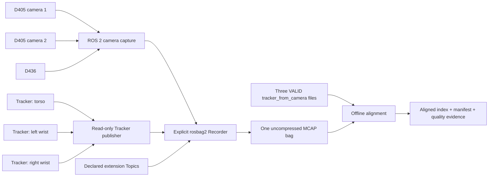

# VisionTactile-Dataset

[](https://github.com/yanglei18/VisionTactile-Dataset/actions/workflows/ci.yml)


[](LICENSE)

[简体中文](README.zh-CN.md) ·
[Desktop workbench](tools/capture_console/README.md) ·
[User manual](docs/user-manual.md) ·
[Interfaces](docs/interface-reference.md) ·
[Troubleshooting](docs/troubleshooting.md)

ROS 2 acquisition, a desktop workbench, and offline alignment for **three Intel
RealSense cameras**, **three VIVE Ultimate Trackers**, and optional **left/right
IMU gloves and tactile arrays**.

The repository provides the software needed to acquire two D405 cameras, one
D436 camera, and three read-only Tracker pose streams into one explicit MCAP
bag. Separate offline tools calibrate each fixed Tracker-to-camera pair and
produce an auditable, host-time-aligned dataset index without modifying the raw
bag.

The desktop workbench adds device configuration, previews, explicit node
control, trial management, and post-record quality reports. It is a **development
preview**, not a fully accepted turnkey hardware product. A synthetic demo runs
without ROS, sensors, private Tracker inputs, or MANO models.

> [!IMPORTANT]
> This is acquisition and post-processing software, not a downloadable
> dataset. Recorded bags, device credentials, Tracker bootstrap material,
> role maps, rig-specific extrinsics, and licensed MANO models are deliberately
> kept outside Git. A clean clone does not include a configured hardware rig.

## Why this project exists

Multi-device experiments often fail silently: the wrong physical device is
assigned to a logical role, ROS QoS drops a stream, a camera clock resets, or a
Recorder exits successfully even though the resulting data are unusable. This
project makes those boundaries explicit:

- cameras are bound by model, serial number, firmware, and ASIC identity;
- Tracker samples are bound to stable experiment roles and physical IDs;
- recording uses an exact, wildcard-free Topic allowlist;
- source clocks and host clocks remain distinguishable;
- Recorder lifecycle success and dataset quality are separate verdicts;
- calibration and alignment outputs are immutable and independently
  verifiable.

## Features

| Capability | Status | Entry point |
| --- | --- | --- |
| Integrated desktop capture console | v0.5 development preview: graphical setup, explicit device control, persistent Tracker setup inputs, four device preview types with enlarged views, trials and post-record reports; full hardware acceptance pending | [Capture console](tools/capture_console/README.md) |
| Two D405 + one D436 capture | Available | `vt_realsense_capture` |
| Per-camera color/depth timing groups | Available | `CameraFrameTiming` |
| Three-Tracker read-only ROS 2 publisher | Available with private runtime inputs | `vt_vive_tracker` |
| RViz2 and standalone Tracker visualization | Available | `vt_vive_tracker`, `vt_vive_tracker_gui` |
| Unified 15-Topic MCAP recording | Available | `capture_controller` |
| Tracker-to-camera hand-eye calibration | Available offline | `tools/tracker_camera_calibration/` |
| Three-camera/three-Tracker alignment | Available offline | `tools/multisensor_alignment/` |
| 12-IMU glove calibration and solid 3D hand visualization | Experimental, standalone; no ROS integration | `tools/glove_hand_pose/` |
| Official FSGlove core / 12-IMU adapter | Original public calibration/inference and shape optimizer connected; physical accuracy unverified | `tools/fsglove12/` |
| Glove ROS bridge and workbench hand preview | Published MANO poses or skeleton fallback; requires external model/runtime for 3D; calibration remains in the original glove window | [Glove bridge](ros2_ws/src/vt_glove_bridge/README.md) |
| Independent left/right pose and tactile modes | Per-hand models, calibration, ROS topics and optional GUIs; left hardware mapping/accuracy still requires validation | [Single/dual-hand guide](ros2_ws/src/vt_glove_bridge/README.md#22-单手双手和仅触觉统一入口) |
| Tactile ROS 2 acquisition and heatmap | 20×20 rolling states, 2D/3D display and offline export; original wire samples retained for bag compatibility | [Tactile guide](ros2_ws/src/vt_tactile_capture/README.md) |
| Glove, tactile, and auxiliary bag extensions | Typed glove/tactile validation and configurable generic selection; exact recording allowlist required | `recording.additional_streams` |
| Cross-camera hardware exposure sync | Not claimed | — |
| Online extrinsic TF or point-cloud fusion | Not implemented | — |

## System overview



The online path only acquires and records data. Tracker-to-camera calibration
and multisensor alignment are independent offline operations.

## Unified bag contract

The default production bag contains **15 Topics**:

| Count | ROS type | Topics |
| ---: | --- | --- |
| 6 | `sensor_msgs/msg/Image` | color and depth for `d405_1`, `d405_2`, and `d436` |
| 3 | `sensor_msgs/msg/CameraInfo` | color intrinsics for all three cameras |
| 3 | `vt_camera_msgs/msg/CameraFrameTiming` | `/d405_1/frame_timing`, `/d405_2/frame_timing`, `/d436/frame_timing` |
| 3 | `vt_tracker_msgs/msg/TrackerSample` | `/vive/left_wrist/sample`, `/vive/right_wrist/sample`, `/vive/torso/sample` |

All core Topics use `keep-last`, depth `30`, `best-effort`, `volatile` recording
QoS overrides. Additional streams must be declared by exact Topic and ROS type;
the Recorder never uses `--all` or wildcard discovery.

The Recorder writes MCAP with rosbag and MCAP compression disabled. At the
reference `1280×720@30` configuration, six raw image streams have an arithmetic
planning rate of approximately **414.72 MB/s**, or **124.4 GB per 300 seconds**.
This estimate is for storage planning, not a throughput guarantee.

`COMPLETE` means that the Recorder process lifecycle ended cleanly. It does
**not** mean that the bag passed identity, timing, coverage, or experimental
quality checks.

## Supported reference system

| Component | Reference configuration |
| --- | --- |
| Operating system | Ubuntu 24.04 |
| ROS distribution | ROS 2 Jazzy |
| RealSense wrapper | RealSense ROS 4.58.1 |
| Cameras | 2 × D405 + 1 × D436 |
| Camera streams | RGB8 + Z16, 1280×720 at 30 Hz |
| Tracking | 3 × VIVE Ultimate Tracker + Wireless Dongle |
| Tracker setup | Windows 10/11 mapping and pairing completed first |
| Bag storage | rosbag2 MCAP, no online compression |

Tested camera identities, firmware versions, and USB topology guidance are
documented in the [hardware reference](docs/hardware-reference.md). A different
camera, firmware, ROS distribution, PyVUT revision, or USB controller is an
unvalidated hardware combination until the acceptance procedure is repeated.

## Quick start

### 1. Clone the repository

```bash
git clone --recurse-submodules \
  https://github.com/yanglei18/VisionTactile-Dataset.git
cd VisionTactile-Dataset

export VT_REPO="$(pwd -P)"
export VT_WS="${VT_REPO}/ros2_ws"
export VT_DATA_ROOT="${HOME}/visiontactile-data"
mkdir -p "${VT_DATA_ROOT}"
```

Keep bags, calibration runs, extrinsics, role maps, bootstrap bundles, and
validation reports outside `VT_REPO`.

If the repository was cloned without submodules, run
`git submodule update --init --recursive` from its root. Keep the recorded
submodule revision; do not replace it with a moving upstream branch. GitHub's
source ZIP does not initialize submodules. The public `pyvut` revision is not
the separately approved extended checkout required by the Tracker publisher;
see [third-party notices](THIRD_PARTY_NOTICES.md).

### 2. Install the public dependencies

Install ROS 2 Jazzy before running the following commands:

```bash
sudo apt update
sudo apt install -y \
  git \
  python3-colcon-common-extensions \
  python3-venv \
  python3-yaml \
  python3-tk \
  libegl1 libgl1 libxkbcommon0 libxcb-cursor0 fonts-noto-cjk \
  ros-jazzy-realsense2-camera \
  ros-jazzy-ros2bag \
  librealsense2-utils \
  fio

source /opt/ros/jazzy/setup.bash
# Run `sudo rosdep init` once if rosdep has not been initialized on this host.
rosdep update
rosdep install --from-paths ros2_ws/src --ignore-src -r -y \
  --rosdistro jazzy
```

Use the system Python for ROS builds and nodes. The desktop installer creates
a separate Qt environment; FSGlove/MANO has its own optional environment.
Do not combine their Qt or model dependencies into the ROS environment. An
active Conda environment is not a supported build or runtime configuration.

### 3. Build and test

```bash
source /opt/ros/jazzy/setup.bash
cd "${VT_WS}"
colcon build --event-handlers console_direct+
source install/setup.bash
colcon test --event-handlers console_direct+
colcon test-result --all --verbose
```

Proceed to hardware operation only when the test result contains zero errors
and zero failures.

### 4. Install and open the desktop workbench

From the checkout root:

```bash
cd "${VT_REPO}"
bash tools/capture_deploy/install.sh
bash tools/capture_deploy/start_demo.sh
```

The installer creates `.venv-capture-console` and current-user desktop/menu
entries. It does not connect sensors, download licensed models, or install a
boot service. For a hardware-free demo, only the Python venv and Qt system
dependencies from step 2 are needed; the ROS installation and build can be
deferred. Demo readings are synthetic and do not record a bag.

After building the ROS workspace, close the demo and open the real workbench:

```bash
bash tools/capture_deploy/start_workbench.sh
```

This starts or connects to the local manager, not the sensors. Open device
configuration, select only the required modules, and provide your own ports,
paths, and device identities. Modules start through explicit controls; opening
the window does not initialize Trackers, calibrate gloves, or record data.
Closing a preview or the workbench does not stop managed devices; use the
device and recording stop controls first when shutdown is intended.

Pose and tactile acquisition can be enabled independently for either hand.
Tactile-only acquisition and 2D display do not require MANO or PyTorch. 3D hand
views require the corresponding licensed left/right model and
a configured FSGlove Python environment. Missing model assets do not turn
synthetic or neutral geometry into live pose data. See the
[workbench guide](tools/capture_console/README.md) and
[single/dual-hand guide](ros2_ws/src/vt_glove_bridge/README.md#22-单手双手和仅触觉统一入口).

Enabling a preview does **not** add its Topic to the recording allowlist. The
following CLI steps describe the default three-camera/three-Tracker recording
workflow; do not launch a second owner of a device already started in the GUI.

### 5. Run the three cameras without recording

```bash
source /opt/ros/jazzy/setup.bash
source "${VT_WS}/install/setup.bash"
ros2 launch vt_realsense_capture triple_realsense.launch.py \
  output_root:="${VT_DATA_ROOT}"
```

Launching the camera stack does not create a bag. Recording begins only after
the controller accepts a manual `START` command. Use the
[capture guide](docs/capture-guide.md) to check the six image streams, three
CameraInfo streams, and three timing streams before recording.

### 6. Prepare the Tracker publisher

The public repository does not pair Trackers, create a Windows map, update
firmware, or generate private bootstrap credentials. Before Linux publication:

1. complete pairing, mapping, and relocalization on Windows;
2. run the documented Linux validation sequence;
3. provide an approved extended PyVUT checkout, bootstrap bundle, and role map
   outside the repository;
4. finish the manual bootstrap, then start the read-only publisher.

```bash
: "${VT_BUNDLE:?set VT_BUNDLE to the approved bundle}"
: "${VT_ROLE_MAP:?set VT_ROLE_MAP to the private role map}"

ros2 launch vt_vive_tracker triple_tracker.launch.py \
  bundle_path:="${VT_BUNDLE}" \
  role_map_path:="${VT_ROLE_MAP}"
```

See the [Windows map procedure](docs/tracker-windows-map.md),
[Linux validation guide](docs/tracker-linux-validation.md), and
[Tracker publisher runbook](docs/tracker-ros2-publisher.md) for the full trust
boundary and startup sequence.

The desktop initialization wizard can save local input paths and invoke an
approved bootstrap script only after explicit consent. Saved paths are not
saved approval or proof of initialization. Once initialization completes,
starting the read-only reader remains a separate action. The wizard does not
replace Windows pairing/mapping or supply private input files.

### 7. Record one unified session

Start the Tracker publisher first, keep the camera launch running, and verify
all 15 core Topics. Then send a unique request:

```bash
ros2 topic pub --once /capture/command \
  vt_camera_msgs/msg/CaptureCommand \
  "{request_id: run-001, command: 1, session_label: trial, planned_duration_sec: 300}"
```

Observe the lifecycle:

```bash
ros2 topic echo /capture/status
```

The successful state sequence is:

```text
IDLE -> RECORDING -> FINALIZING -> COMPLETE
```

To stop early, use a new request ID and wait for `COMPLETE`:

```bash
ros2 topic pub --once /capture/command \
  vt_camera_msgs/msg/CaptureCommand \
  "{request_id: stop-001, command: 2, session_label: '', planned_duration_sec: 0}"
```

Inspect the finalized bag with:

```bash
ros2 bag info "${VT_DATA_ROOT}/<session-id>/bag"
```

### 8. Align the bag offline

Alignment requires three identity-bound calibration results with
`status: VALID`. Install the offline tool in an isolated environment that can
still access the ROS installation:

```bash
source /opt/ros/jazzy/setup.bash
source "${VT_WS}/install/setup.bash"
python3 -m venv --system-site-packages "${HOME}/.venvs/vt-alignment"
source "${HOME}/.venvs/vt-alignment/bin/activate"
python -m pip install "${VT_REPO}/tools/multisensor_alignment"

vt-multisensor-align --version
```

Copy the example configuration outside Git, bind it to the real hardware and
Topic identities, then run:

```bash
export BAG="${VT_DATA_ROOT}/<session-id>/bag"
export ALIGN_CONFIG="${VT_DATA_ROOT}/config/alignment.yaml"
export EXTRINSICS_DIR="${VT_DATA_ROOT}/calibration/accepted"
export ALIGN_OUTPUT="${VT_DATA_ROOT}/<session-id>/aligned-v01"

vt-multisensor-align inspect \
  --bag "${BAG}" \
  --config "${ALIGN_CONFIG}"

vt-multisensor-align align \
  --bag "${BAG}" \
  --config "${ALIGN_CONFIG}" \
  --extrinsics "${EXTRINSICS_DIR}" \
  --output "${ALIGN_OUTPUT}"

vt-multisensor-align validate --output "${ALIGN_OUTPUT}"
```

The tool does not rewrite or decode the raw image payloads. It produces an
atomic alignment directory containing a manifest, stream catalog, JSONL frame
index, timing residuals, quality report, diagnostic plot, and integrity hashes.
Follow the [single-entry alignment manual](tools/multisensor_alignment/README.md)
for configuration, acceptance thresholds, output semantics, and recovery.

## Time and transform semantics

The project does not treat every timestamp as interchangeable.

| Stream | Alignment time | Independent audit time |
| --- | --- | --- |
| Camera frame group | `group_host_realtime_ns` | `group_host_monotonic_raw_ns` |
| Tracker sample | `host_realtime_ns` | `host_monotonic_ns` |
| Generic extension | configured header or integer nanosecond field | none unless a typed adapter provides one |

Camera device/source timestamps remain provenance fields. In particular, a
D436 device-clock reset must not redefine the dataset wall-clock timeline.
`CLOCK_MONOTONIC_RAW` and `CLOCK_MONOTONIC` are audited within their own
streams; their numeric values are never compared directly.

The offline transform convention is:

```text
vive_map_from_camera = vive_map_from_tracker * tracker_from_camera
```

Each external calibration is bound to one camera identity, one Tracker role
and physical ID, and the expected parent/child frames. Invalid, mismatched, or
ambiguous calibration files are rejected.

## Extending the dataset contract

Glove, tactile, and other ROS streams can join the same bag
without changing the 15-Topic core:

1. add the exact Topic and ROS type to `recording.additional_streams` in the
   capture configuration;
2. add the same stream identity and timestamp field to the alignment
   configuration;
3. choose bounded `nearest` or causal `previous` selection;
4. mark the stream required only when its coverage must gate acceptance;
5. version and preserve the resulting configuration with the dataset evidence.

The generic adapter selects a whole serialized message reference. Dedicated
branches already validate `vt_glove_msgs/msg/GloveState` and
`vt_tactile_msgs/msg/TactileSampleArray`, including their source-time and
continuity boundaries. They do not interpolate glove joints or create missing
observations. See the [alignment manual](tools/multisensor_alignment/README.md)
for the matching configurations and tactile reconstruction export.

## Repository layout

```text
VisionTactile-Dataset/
├── ros2_ws/src/
│   ├── vt_camera_msgs/          # Camera timing and capture interfaces
│   ├── vt_realsense_capture/    # Three-camera launch and Recorder controller
│   ├── vt_tracker_msgs/         # Tracker sample/status interfaces
│   ├── vt_vive_tracker/         # Read-only Tracker publisher and RViz client
│   ├── vt_vive_tracker_gui/     # Standalone Tracker visualization
│   ├── vt_capture_core/         # ROS-independent workbench models and protocol
│   ├── vt_capture_manager/      # ROS monitoring and opt-in device/recording control
│   ├── vt_glove_msgs/           # Glove pose and provenance interfaces
│   ├── vt_glove_bridge/         # Independent left/right pose bridges
│   ├── vt_tactile_msgs/         # Tactile wire samples and rolling-state interfaces
│   └── vt_tactile_capture/      # Serial acquisition, display, and replay
├── tools/
│   ├── capture_console/            # Isolated Qt desktop workbench and demo
│   ├── capture_deploy/             # Installer and explicit launch scripts
│   ├── tracker_camera_calibration/ # Offline hand-eye calibration
│   ├── multisensor_alignment/      # Offline unified-bag alignment
│   ├── glove_hand_pose/            # Experimental standalone 12-IMU hand model
│   ├── fsglove12/                  # External FSGlove core + sparse IMU/MANO adapter
│   ├── vut_validation/             # Tracker validation utilities
│   ├── release/                    # Source-candidate checks and clean export
│   └── check_public_tree.py        # Public-release repository gate
├── docs/                        # Architecture, operations, and troubleshooting
├── pyvut/                       # Upstream-derived Git submodule
├── CONTRIBUTING.md
├── SECURITY.md
└── LICENSE
```

Build outputs (`build/`, `install/`, `log/`), bags, packet captures, generated
calibrations, private Tracker inputs, and experimental artifacts are not source
files and must not be committed.

## Documentation

### Operate the system

- [Desktop installation, device setup, previews, and trials](tools/capture_console/README.md)
- [End-user manual](docs/user-manual.md)
- [Unified capture guide](docs/capture-guide.md)
- [Launch arguments, Topics, QoS, and CLI reference](docs/interface-reference.md)
- [Hardware reference and USB topology](docs/hardware-reference.md)
- [Troubleshooting by symptom](docs/troubleshooting.md)

### Work with Trackers

- [Windows mapping and pairing boundary](docs/tracker-windows-map.md)
- [Linux validation](docs/tracker-linux-validation.md)
- [ROS 2 Tracker publisher and visualization](docs/tracker-ros2-publisher.md)

### Calibrate and align

- [Tracker-to-camera calibration overview](docs/tracker-camera-calibration.md)
- [Complete calibration operations manual](tools/tracker_camera_calibration/README.md)
- [Complete unified-bag alignment manual](tools/multisensor_alignment/README.md)
- [Architecture and data flow](docs/architecture.md)

### Explore glove hand poses

- [Standalone 12-IMU calibration, raw replay, and solid 3D hand guide (Chinese)](tools/glove_hand_pose/README.md)
- [Glove tool dependency and distribution notices](tools/glove_hand_pose/THIRD_PARTY_NOTICES.md)
- [Official FSGlove core, 12-IMU adaptation, calibration and prerequisites (Chinese)](tools/fsglove12/README.md)
- [Glove ROS bridge and independent left/right operation](ros2_ws/src/vt_glove_bridge/README.md)
- [Tactile acquisition, layouts, replay, and reconstruction](ros2_ws/src/vt_tactile_capture/README.md)

The older `glove_hand_pose` prototype is separate from ROS recording and
alignment; `fsglove12` has a ROS bridge. Sparse-input hand reconstruction remains
experimental: unmeasured joints are model estimates, six-axis heading can
drift, and real-hand accuracy has not been validated.

### Develop and release

- [Contributing guide](CONTRIBUTING.md)
- [Maintainer release checklist](docs/release-checklist.md)
- [Public source preparation and export](tools/release/README.md)
- [Changelog](CHANGELOG.md)
- [Security policy](SECURITY.md)
- [Third-party notices](THIRD_PARTY_NOTICES.md)

## Verification

Software checks cover ROS packages, public-tree rules, Tracker validation,
calibration, alignment, workbench lifecycle/UI, and glove/tactile data paths.
The alignment tests include an MCAP round trip using real ROS message
serialization. Hardware-free tests and synthetic ROS tests do not demonstrate
physical sensor accuracy, timing performance, or successful full-rig operation.

After installing the test environments in [CONTRIBUTING.md](CONTRIBUTING.md),
use its pytest commands for the offline and GUI suites. Useful repository
checks are:

```bash
cd "${VT_WS}"
colcon test --event-handlers console_direct+
colcon test-result --all --verbose

cd "${VT_REPO}"
python3 tools/test_check_public_tree.py
python3 tools/release/prepare_release.py check
```

The release check examines the current source candidate without staging files;
the separate `tools/check_public_tree.py` check reads the Git index. Neither a
passing test suite nor a clean current tree establishes that older Git history
is safe to publish. Follow the [release preparation guide](tools/release/README.md)
before the first public upload; do not push an existing history without review.

Automated tests do not replace the reference-hardware acceptance procedure.
For a release or a new hardware combination, run the documented 30-second and
300-second camera/Tracker recording checks, inspect the resulting bag, and
validate the offline alignment output.

## Scope and known limitations

- There is no cross-camera hardware trigger or simultaneous-exposure claim.
- `CameraFrameTiming` is exact color/depth software grouping within one camera,
  not proof of exposure synchronization across cameras.
- Tracker coordinates remain in the Windows-created native `vive_map`; the
  publisher does not emit extrinsic TF.
- Tracker pairing, mapping, firmware updates, and private bootstrap generation
  are outside the Linux read-only publisher.
- Calibration bags are separate from production bags. Three physical
  Tracker-to-camera transforms must be calibrated and accepted for each rig.
- The alignment tool matches host realtime with bounded residuals and reports
  coverage. It does not manufacture missing observations or extrapolate poses.
- Point-cloud fusion, online alignment, and typed glove interpolation are not
  part of this release.
- The workbench is a development preview. Full camera/Tracker/glove/tactile
  hardware acceptance, long-duration reliability, and left-hand mapping and
  pose accuracy remain separate validation tasks.
- Workbench tactile colors are raw ADC, not calibrated pressure or baseline
  differences. Its static MANO tactile view and dynamic glove pose view are
  separate; synchronized pose–tactile overlay is not implemented there.
- Optional hand models and Tracker runtime inputs are external prerequisites,
  not dependencies that a public clone or desktop installer supplies.

## Contributing

Contributions are welcome. Before opening a pull request:

1. read [CONTRIBUTING.md](CONTRIBUTING.md);
2. keep generated data and private hardware material out of Git;
3. add or update tests for behavioral changes;
4. update the relevant interface and operations documentation;
5. run the ROS, offline-tool, and public-tree checks.

Use GitHub Issues for reproducible, non-sensitive defects and feature requests.
Report vulnerabilities or credential exposure only through the private process
in [SECURITY.md](SECURITY.md).

## License and third-party software

Project-authored source and documentation are licensed under
[Apache-2.0](LICENSE). The `pyvut` submodule and all other third-party
components retain their respective upstream licenses and are not relicensed by
this project. See [THIRD_PARTY_NOTICES.md](THIRD_PARTY_NOTICES.md) before
redistributing a combined build.

MANO assets must be obtained by the user under the model's own terms; no model
files or derived mesh cache are shipped. Original FSGlove source, the approved
extended Tracker checkout, and private bootstrap/capture/role-map inputs are
also not bundled. Keep these and per-machine configuration outside public
source archives; see the [FSGlove notices](tools/fsglove12/THIRD_PARTY_NOTICES.md).

## Citation

When using this software in a publication or released dataset, cite the exact
Git commit and configuration alongside the repository URL:

```bibtex
@software{visiontactile_dataset,
  title  = {VisionTactile-Dataset},
  author = {VisionTactile-Dataset contributors},
  year   = {2026},
  url    = {https://github.com/yanglei18/VisionTactile-Dataset}
}
```
